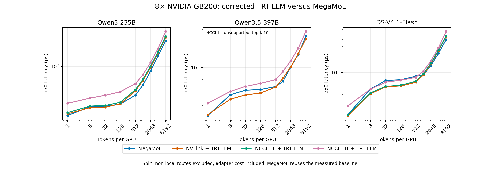
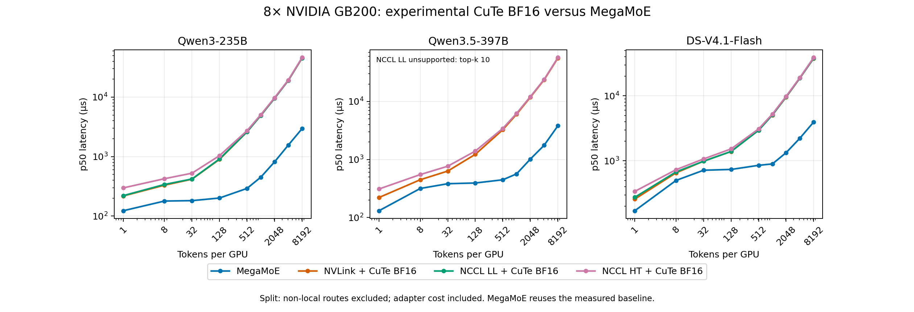

# 8× NVIDIA GB200 results

Updated: 2026-10-20. **Both BF16 comparisons are complete:** 27 MegaMoE,
72 corrected TRT-LLM split, and 72 experimental CuTe DSL split cases passed.
Each comparison file contains 99 passes and nine expected skips; the same
27 MegaMoE baseline rows appear in both. There are **171 distinct passing
measurements**, not 198.

## Hardware and method

Measured on an **8× NVIDIA GB200 machine**, EP8 / TP1. All measured weights
and activations are BF16. These are shape microbenchmarks with synthetic
routing and weights, unclamped SwiGLU, and no shared experts or router compute.

CUDA graph replay uses five warmups, 30 samples, and ten forwards per sample.
Each sample uses the slowest rank. Timing includes dispatch, compute, combine,
and per-forward adapter work. JIT, tuning, weight preparation, and reference
checks are outside timing. See [runtime details](environment.json) and the
[portable repro](../../README.md). B200 performance is unmeasured.

## MegaMoE versus corrected TRT-LLM

Values are p50 latency in µs. One and eight tokens/GPU are decode proxies;
4,096 and 8,192 tokens/GPU are prefill proxies. These are layer times, not
request latency.

| Shape | Tokens/GPU | MegaMoE | NVLink + TRT-LLM | NCCL LL + TRT-LLM | NCCL HT + TRT-LLM |
|---|---:|---:|---:|---:|---:|
| Qwen3 | 1 | 123.15 | 132.30 | 139.19 | 207.86 |
| Qwen3 | 8 | 179.22 | 171.59 | 183.19 | 258.79 |
| Qwen3 | 4096 | 1561.60 | 1771.02 | 1844.51 | 2113.53 |
| Qwen3 | 8192 | 2950.40 | 3423.51 | 3566.32 | 4396.08 |
| Qwen3.5 | 1 | 130.29 | 134.57 | unsupported | 220.87 |
| Qwen3.5 | 8 | 315.51 | 261.59 | unsupported | 361.53 |
| Qwen3.5 | 4096 | 1751.59 | 1797.25 | unsupported | 2267.65 |
| Qwen3.5 | 8192 | 3802.26 | 3386.83 | unsupported | 4632.71 |
| DS-V4.1 | 1 | 170.87 | 164.52 | 168.19 | 247.93 |
| DS-V4.1 | 8 | 500.02 | 409.90 | 425.28 | 496.91 |
| DS-V4.1 | 4096 | 2232.30 | 2481.47 | 2548.72 | 2826.85 |
| DS-V4.1 | 8192 | 3954.88 | 4503.50 | 4654.69 | 5558.26 |



[Full raw token sweep](corrected.jsonl). The [README](../../README.md#result-files-and-generated-views)
shows how to generate a full table or plot.

NVLink + TRT-LLM is faster than MegaMoE at eight tokens/GPU for all three
shapes. MegaMoE is faster than every corrected TRT-LLM transport at 4,096
tokens/GPU. At 8,192, Qwen3.5 NVLink + TRT-LLM is faster than MegaMoE.
NCCL HT does not win these selected prefill cases; its name alone does not
establish the best transport.

## BF16 CuTe DSL with separate communication

The public Blackwell `CuteDslConfig` uses 4-bit weights. To keep BF16 weights,
[the experimental adapter](../../bench_cute_bf16.py) reuses the lower-level
SM100 fused BF16 FC1+FC2 kernel from MegaMoE. GPU sorting, padded gather,
counter reset, and FP32 output reduction are timed. It uses a fixed tile
configuration and is not an autotuned production split backend.

Values below are p50 latency in µs. All three transports use BF16 weights and
activations; no W4A16 results are included.

| Shape | Tokens/GPU | MegaMoE | NVLink + CuTe BF16 | NCCL LL + CuTe BF16 | NCCL HT + CuTe BF16 |
|---|---:|---:|---:|---:|---:|
| Qwen3 | 1 | 123.15 | 218.08 | 220.74 | 297.77 |
| Qwen3 | 8 | 179.22 | 331.10 | 339.99 | 425.37 |
| Qwen3 | 4096 | 1561.60 | 19002.31 | 19075.76 | 19386.02 |
| Qwen3 | 8192 | 2950.40 | 45058.09 | 45396.49 | 46143.93 |
| Qwen3.5 | 1 | 130.29 | 220.38 | unsupported | 308.99 |
| Qwen3.5 | 8 | 315.51 | 446.56 | unsupported | 547.99 |
| Qwen3.5 | 4096 | 1751.59 | 23586.88 | unsupported | 23971.38 |
| Qwen3.5 | 8192 | 3802.26 | 55919.89 | unsupported | 57140.48 |
| DS-V4.1 | 1 | 170.87 | 258.13 | 275.03 | 339.00 |
| DS-V4.1 | 8 | 500.02 | 654.53 | 676.43 | 731.74 |
| DS-V4.1 | 4096 | 2232.30 | 18741.22 | 18834.63 | 19135.79 |
| DS-V4.1 | 8192 | 3954.88 | 37700.97 | 37830.90 | 38788.66 |



[Full raw CuTe sweep](cute-bf16.jsonl).

This CuTe adapter is slower than corrected TRT-LLM in all 72 paired cases,
by 1.37–16.51× in p50 latency.
These results measure this adapter, not the performance limit of CuTe compute.
A separate Qwen3 prefill [profile](cute-profile.json) shows that copies, masking,
and FP32 scatter reduction dominate: the fused BF16 FC1+FC2 kernel takes
0.818–0.920 ms across ranks, while scatter reduction alone takes 7.473–7.971 ms.
That profile is one warmed eager compute call per rank, excluding dispatch
and combine; it is not a graph latency decomposition.

The profile uses Qwen3 at 4,096 tokens/GPU with NVLink one-sided communication.
The adapter copies and reduces the full receive capacity, including masked
routes: 32,768 token slots × eight routes × hidden width 4,096 per rank.
CPU operator entries and their CUDA kernel entries in the raw profile overlap;
do not sum both. To reproduce the profile after the environment setup:

```bash
export PROFILE_DIR="$PWD/results/cute-profile"
python -m torch.distributed.run --standalone --nproc-per-node=8 profile_cute_bf16.py \
  --model qwen3 --backend nvlink --tokens 4096 \
  --mode eager --warmup 2 --repeat 1 --inner 1 \
  --output results/cute-profile/diagnostic.jsonl
```

Use the same multi-host launcher setup as the benchmark if needed. Profile
output is separate from the latency sweep.

## Correctness

All 171 passing measurements in the two BF16 comparisons pass the sampled
FP32 reference before timing and after graph warmup; every output is finite.
Maximum relative L2 error is **0.003866**, below the 0.03 limit.
The reference checks up to eight spread-out tokens per rank. BF16 rounding
can differ because MegaMoE and the CuTe adapter apply routing weights before
FC2, while TRT-LLM applies them after FC2. Correctness thresholds were not relaxed.

Qwen3.5 NCCL LL is skipped because top-k 10 exceeds the checked limit of eight.
Top-k is unchanged. Failed worker launches were rerun; accepted timings require
all launcher processes to exit successfully. Three CuTe cases were rerun on a
later 8× GB200 allocation. A [separate timing check](repeatability-check.jsonl)
repeated Qwen3 NVLink + TRT-LLM at eight tokens/GPU: 172.12 µs versus
171.59 µs previously (+0.31%). That repeat is excluded from the matrix counts.
Published data omit site paths and launcher logs. Eight CPU harness tests pass.
